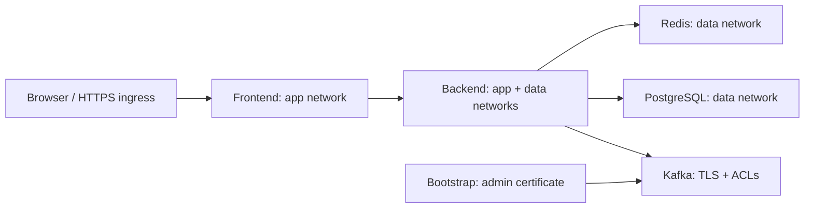

# Self-hosted Compose Kafka security

Date: 2026-11-18. Deployment target explicitly selected by the user: self-hosted Docker Compose. The configuration has been tested with disposable Kafka containers; it has not been deployed to the user's existing stack or volumes.

## Identity and network design

Production Compose uses TLS client authentication for both broker and controller listeners, requires client certificates, and keeps hostname verification enabled. The KRaft StandardAuthorizer uses certificate identities and denies resources without an applicable ACL. This follows the [Kafka SSL configuration model](https://kafka.apache.org/37/security/encryption-and-authentication-using-ssl/) and [Kafka KRaft authorization model](https://kafka.apache.org/37/security/authorization-and-acls/).

| Identity | Credential placement and authority |
| --- | --- |
| CN=roottrace-broker | Broker container only; server/client certificate for broker/controller communication and local authenticated health checks. Super-user authority for internal broker operation. |
| CN=roottrace-admin | One-shot bootstrap container only; creates the four application topics and application ACLs. Super-user authority. |
| CN=roottrace-backend | Backend container only; client certificate with topic Read/Write/Describe on raw-logs, incoming-alerts, raw-logs-dlq, incoming-alerts-dlq; group Read/Describe for roottrace-log-processor and roottrace-alert-processor; cluster IdempotentWrite. No arbitrary topic creation or ACL administration. |

Application topic auto-creation is disabled in both the broker and generated Spring configuration. The bootstrap container creates the topics/ACLs before the backend starts. Its commands are repeatable. The backend never receives the broker/admin private keys or CA signing key. This is service-level isolation: a trusted backend producer can still assert workspace metadata. Customers must ingest through authenticated HTTP, not direct Kafka access.

PostgreSQL, Redis, broker, and bootstrap share an internal data network. Only the backend joins both the data and application networks. The frontend cannot join the data network. No database/cache/broker/controller ports are published to the host. Frontend/backend host ports bind to loopback; public HTTPS termination and ingress configuration are separate deployment requirements. The frontend uses a same-origin API route compiled to http://backend:8080 inside its container network.



## Generate and protect deployment credentials

Use JDK 21 from the repository root:

```powershell
java scripts/KafkaCertificates.java .secrets/kafka
```

The source launcher invokes the JDK keytool directly; password arguments reference files rather than embedding passwords in process command lines. The [JDK 21 keytool reference](https://docs.oracle.com/en/java/javase/21/docs/specs/man/keytool.html) documents certificate generation/import and password option modifiers.

The output directory must be empty. The generator never overwrites an existing PKI. It creates a private CA, separate broker/admin/backend PKCS12 stores, a common public truststore, secret properties files, and an initial random cluster ID. Leaf certificates are valid for 365 days; the broker certificate has DNS:kafka and server/client usage. Client certificates have client usage only. TLSv1.2/TLSv1.3 are enabled. Passwords use 32 random bytes and are not printed. Generated .secrets files are Git-ignored; frontend Docker contexts also exclude environment files, secrets, and logs.

On POSIX filesystems the generator restricts the directory/files to the creating owner. On Windows, review and restrict inherited NTFS ACLs before using real deployment credentials. File-based Compose secrets must be readable by the intended runtime UID (1000 for broker/backend); arrange host ownership/ACLs accordingly rather than making private keys broadly readable. Protect the host and Docker daemon as privileged infrastructure.

Keep ca.p12 and ca.password in protected offline signing custody after provisioning. They are not mounted into any service. Back up signing material, issued credentials, and broker metadata securely. The generator is a bootstrap helper, not an automatic certificate renewal/revocation system. Plan renewal before leaf expiry. Renew with the existing CA or perform a deliberate trust migration; generating a new CA in another directory does not make it trusted by an already-running broker.

The default secret directory is ./.secrets/kafka. ROOTTRACE_KAFKA_SECRETS_DIR can select a reviewed alternative directory. Compose mounts only the files each service needs; it does not mount that whole directory. backend-spring.properties is a mandatory Spring config import, so missing TLS material fails startup instead of falling back to plaintext.

## Existing storage and rollout

Do not run the production Compose up command against an existing Kafka stack as an unreviewed upgrade. Stop/drain compatible application writers under the established migration plan, inspect existing broker configuration/storage, back up metadata/data and current credentials, and identify the existing cluster ID. For an existing broker, the generated cluster.id must be deliberately replaced with that exact existing ID before startup. Do not invent a new identity for retained data.

The startup script compares existing root meta.properties with the configured cluster ID and refuses a mismatch. It also refuses to initialize a non-empty data directory without recognized root metadata. It formats only an empty new data directory or invokes ignore-formatted for the matching existing metadata. It never deletes or resets storage.

The new config explicitly uses /var/lib/kafka/data, matching the named volume. The older Compose file mounted that volume without explicitly setting Kafka log.dirs; its actual metadata may be elsewhere in the old container. Inspect the real old log directory and plan a reviewed migration rather than assuming the named volume holds all old data. No storage movement or existing-container restart was performed by this implementation.

After preparing reviewed secrets and required application environment variables, validate configuration before deployment:

```powershell
docker compose -f docker-compose.prod.yml config --quiet
```

The existing deployment command starts the TLS broker, waits for its authenticated health check, runs the privileged topic/ACL bootstrap, then starts the backend. Keep generated property files out of support tickets, logs, and version control. Do not use unredacted docker compose config output when real environment credentials are present. Local development docker-compose.yml remains a separate plaintext development setup and must not be used as the production configuration.

## Validation and remaining boundaries

SecureKafkaIntegrationTest generates test-only PKI and starts an isolated real Kafka 3.7.0 broker with the actual startup/bootstrap scripts. It verifies authorized publish/consume, denied arbitrary topic creation, missing-client-certificate rejection, server-hostname mismatch rejection, Spring TLS property binding, disabled application topic creation, and mismatched cluster-ID refusal. A separate throwaway-container probe verified that non-empty unknown storage is rejected before formatting. Compose validation checks network isolation, missing infrastructure host ports, bootstrap ordering, absence of admin keys on the backend, and the frontend's container proxy target. The frontend build's compiled routes manifest confirms the same-origin rewrite destination.

No full application Compose stack, public endpoint, live certificate rollout, or user volume was started/changed. The single combined broker/controller has replication factor one and is not highly available. Certificate renewal/revocation automation, backup/restore drills, public HTTPS ingress, dependency/image patch review, resource/load sizing, alert delivery, and operational retention remain production work. Existing pinned framework/image versions were retained for compatibility; this is not a current-version or vulnerability-free certification. Workspace queues are observed separately through [QUEUE_MONITORING.md](QUEUE_MONITORING.md).
